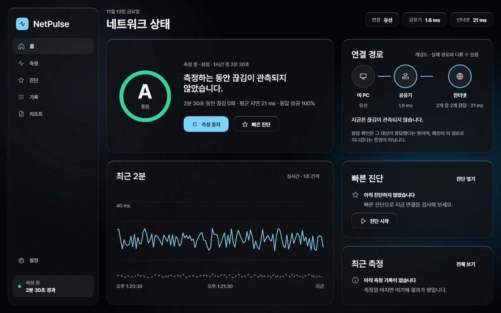
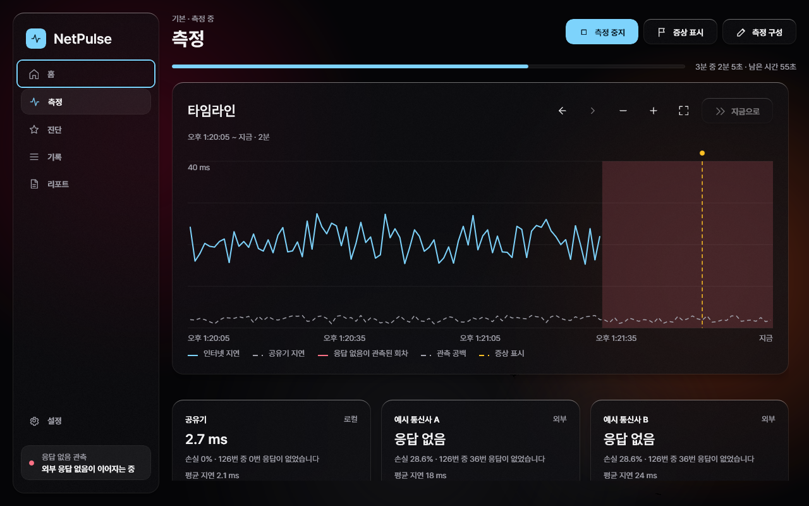
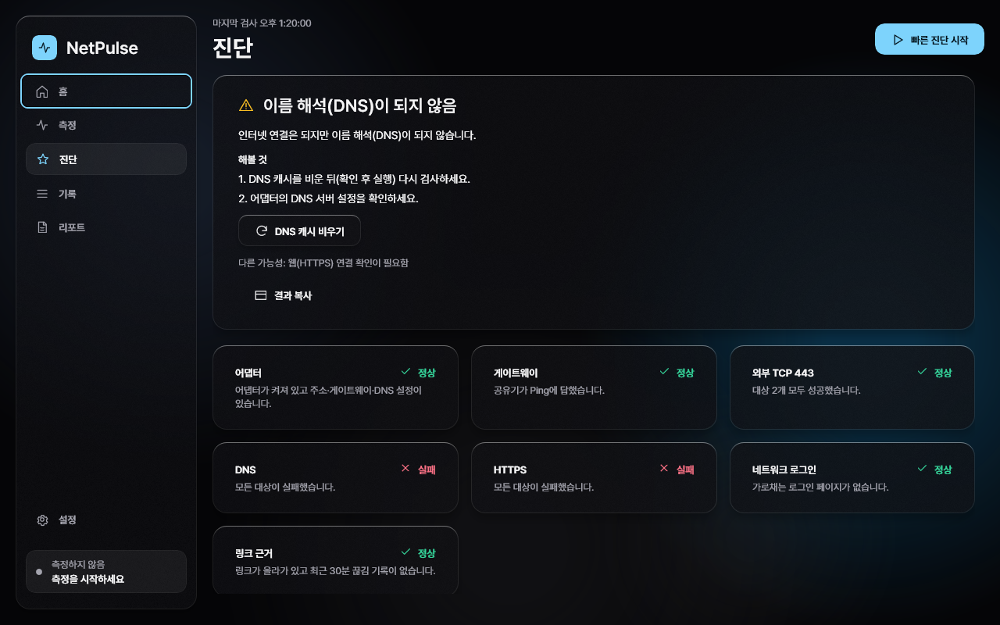
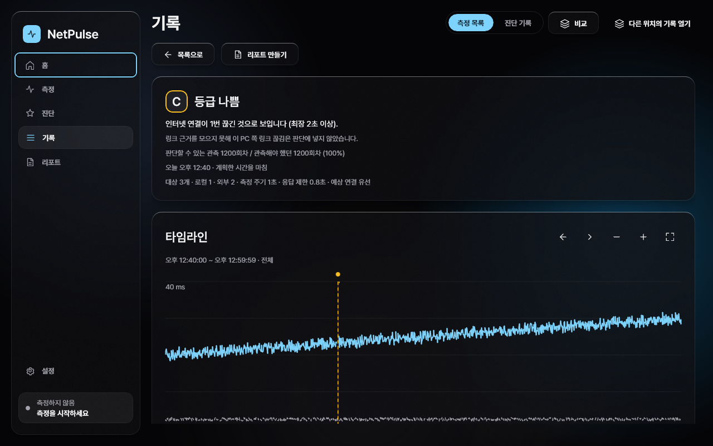
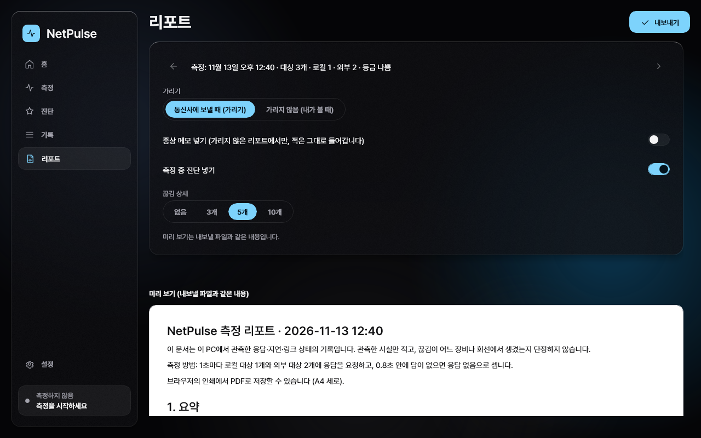
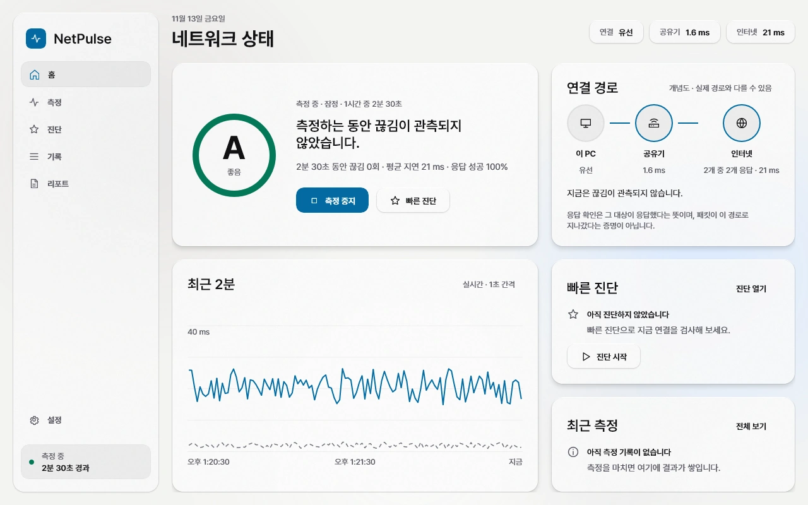
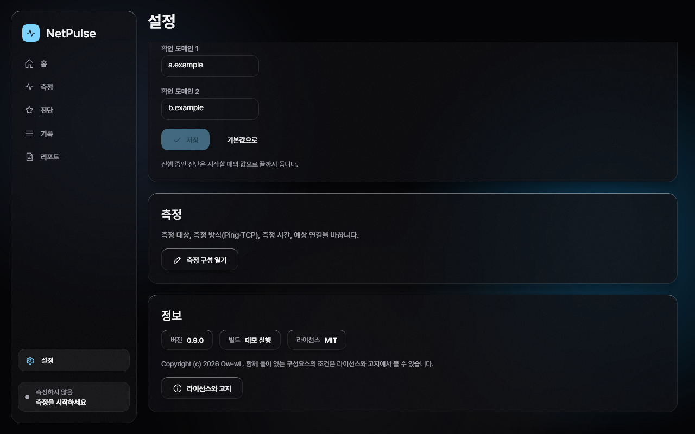

# NetPulse

NetPulse는 Windows 11에서 **간헐적인 네트워크 끊김을 기록하고, 어디서 끊겼는지 근거를 모아 보여 주는** 진단 앱입니다.
측정을 켜 두면 공유기와 외부 대상까지 여러 곳을 함께 재고, 끊김이 생기면 그 순간의 근거(응답, 경로, 링크 상태)를 기록합니다.
통신사에 보낼 리포트도 만들 수 있습니다.



## 주요 기능

- **측정**: 공유기·외부 대상 여러 곳에 1초마다 Ping(또는 TCP 포트)을 보내 응답 없음과 지연을 겹친 타임라인으로 보여 줍니다. 처음 실행하면 연결을 확인해 측정 대상을 제안합니다.
- **Wi‑Fi 신호**: 무선으로 연결돼 있으면 신호 품질을 함께 기록해 타임라인과 리포트에 겹쳐 보여 줍니다. 위치 권한이 필요 없는 정보만 읽고, 네트워크 이름(SSID)은 기록하지 않습니다.
- **끊김 판정**: 끊김마다 어느 구간(내 PC·공유기·통신사 쪽 등)을 먼저 확인할지 관측한 근거와 함께 보여 줍니다. 단정하지 않고 근거 상태를 함께 적습니다.
- **증상 표시와 메모**: 끊김을 느낀 순간을 버튼 하나로 표시하고 메모를 남깁니다.
- **빠른 진단**: 어댑터, 공유기(게이트웨이), 외부 연결, DNS, HTTPS, 네트워크 로그인, 링크 상태를 단계별로 확인합니다. 사이트 하나의 DNS·HTTPS도 따로 확인할 수 있습니다.
- **기록**: 지난 측정을 다시 열고, 끊김 목록·통계를 보고, 두 측정을 비교합니다.
- **리포트**: 측정 하나를 HTML 파일 하나로 내보냅니다. 기본으로 주소 같은 식별 정보를 가립니다.
- **상주**: 측정 중에 창을 닫으면 알림 영역(트레이)에서 측정을 계속하고, 끊기면 풍선 알림으로 알려 줍니다.
- **보기**: 다크·라이트 테마, 고대비·효과 줄이기·움직임 줄이기, 키보드 조작, 배율 150%를 지원합니다.

| 측정 | 진단 |
| --- | --- |
|  |  |
| **기록** | **리포트** |
|  |  |
| **라이트 테마** | **설정** |
|  |  |

화면 캡처는 모두 데모 모드(합성 데이터)에서 찍었습니다.

## 받기와 실행

1. [Releases](https://github.com/Ow-wL/NetPulse/releases)에서 `NetPulse-<버전>-win-x64.zip`을 받아 압축을 풀거나, `NetPulse-<버전>-win-x64.exe` 하나만 받습니다.
2. 설치하지 않습니다. 원하는 폴더에서 실행하면 됩니다.
3. 처음 실행할 때 **사용 조건**에 동의해야 합니다 (아래 "라이선스").

- 요구 사항: Windows 11 (x64). 다른 런타임을 따로 설치할 필요가 없습니다.
- 코드 서명이 없어 Windows SmartScreen 경고가 나올 수 있습니다. [추가 정보] → [실행]으로 열 수 있습니다.
- 받은 파일은 같은 Release의 `SHA256SUMS.txt`로 확인할 수 있습니다.

### 알려진 문제 (1.0.0)

- 일부 금융 보안 프로그램(예: RaonSecure TouchEn nxWeb)이 설치된 PC에서 NetPulse가 시작 직후 꺼진 일이 있습니다 (예외 코드 0xc0000005).
  그 PC에서는 여러 금융 보안 프로그램을 함께 지우고 재부팅한 뒤 정상 실행을 확인했습니다. 다시 재현하지 못해 원인은 아직 확인하지 못했습니다.
  같은 일이 생기면 이슈로 알려 주세요. 앱은 시작 단계를 `%LOCALAPPDATA%\NetPulse\startup-trace.jsonl`에 남깁니다(단계 이름과 시각만). 그 파일을 함께 보내 주시면 원인을 찾는 데 도움이 됩니다.

## 개인정보

- 기록과 설정은 이 PC에만 저장됩니다 (`%LOCALAPPDATA%\NetPulse`, 기록 위치는 설정에서 바꿀 수 있음).
- 관리자 권한을 요청하지 않고 네트워크 설정을 바꾸지 않습니다. DNS 캐시 비우기는 확인한 뒤에만 합니다.
- 리포트는 내보낼 때만 파일로 만들어지고, 기본으로 주소·어댑터 이름 같은 식별 정보를 가립니다.

## 직접 빌드

필요한 것: Windows 11, `global.json`에 적힌 .NET SDK.

```powershell
git clone https://github.com/Ow-wL/NetPulse.git
cd NetPulse
./build/build.ps1
```

복원 → 빌드 → 로직·통합 시험 → 단일 파일 배포 → 고지·경로 검사 → 묶기 순서로 돌고, 결과는 `artifacts/<커밋 앞 10자리>/release/`에 생깁니다.

| 파일 | 내용 |
| --- | --- |
| `NetPulse-<버전>-win-x64.zip` | `NetPulse.exe`, `LICENSE.txt`, `TERMS.txt`, `THIRD-PARTY-NOTICES.txt`, `읽어보기.txt` |
| `NetPulse-<버전>-win-x64.exe` | zip 안과 같은 exe |
| `SHA256SUMS.txt` | 두 파일의 SHA-256 |
| `release.json` | 버전, 원본 커밋, 파일 해시 |

## 개발

- 구조: `src/NetPulse.Core`(측정·판정·기록), `src/NetPulse.Platform`(Windows 연동), `src/NetPulse.Design`(디자인 토큰·설정), `src/NetPulse.App`(WinUI 3 앱).
- 로직 시험: `dotnet test --project tests/NetPulse.Core.Tests` (Design·Platform도 같은 방식). CI가 `build/build.ps1`을 돌립니다.
- UI 시험: `./build/build.ps1 -Gate` 뒤 `./build/ui-test.ps1 -Artifacts artifacts/<sha10>` (PC 화면을 쓰므로 실행 중에는 PC를 쓰지 않습니다).
- 데모 모드: `NetPulse.exe --demo steady` (합성 데이터로 실제 네트워크 없이 화면을 봅니다).
- 개발 기록: [`docs/loop-plan.md`](docs/loop-plan.md), [`docs/loop/STATE.md`](docs/loop/STATE.md), [`docs/loop/DECISIONS.md`](docs/loop/DECISIONS.md).

## 라이선스

- NetPulse의 코드와 문서는 [MIT 라이선스](LICENSE)입니다. Copyright (c) 2026 Ow-wL
- 배포 파일에는 Microsoft Windows App SDK, .NET 런타임 같은 제3자 구성요소가 들어 있고, 각자의 조건이 적용됩니다: [제3자 고지](src/NetPulse.App/Legal/THIRD-PARTY-NOTICES.txt).
- 그래서 앱을 쓰거나 다시 배포하려면 [사용 조건](src/NetPulse.App/Legal/TERMS.txt)에 동의해야 합니다. 다시 배포할 때는 사용 조건, LICENSE, 제3자 고지를 함께 전해야 합니다.
- 내장한 Pretendard 1.3.9 글꼴은 [SIL Open Font License](assets/fonts/OFL-Pretendard.txt)입니다.
